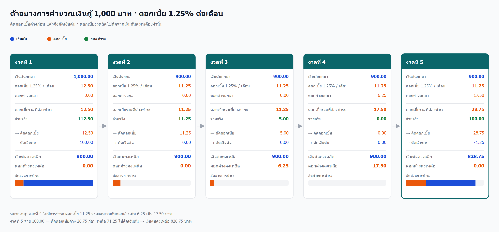

# แผนออกแบบระบบสินเชื่อเงินกู้ (Loan System Plan)

> สถานะ: **วางแผนเท่านั้น — ยังไม่เขียนโค้ด**
> เจ้าของโปรเจกต์: bank-village (NestJS + Prisma + Nuxt 3)

---

## 1. สรุปเงื่อนไขทางธุรกิจ (Business Rules)

### 1.1 เงื่อนไขการกู้

| # | เงื่อนไข |
|---|---|
| L1 | เงินต้นตั้งต้น (principal) บันทึกเป็นยอดหนี้ของสัญญา |
| L2 | ดอกเบี้ย **1.25% ต่อเดือน** (ค่าตั้งต้น) คิดจาก **เงินต้นคงเหลือ** |
| L3 | เป็น **ดอกเบี้ยเชิงเดี่ยว (simple interest)** — ดอกเบี้ยค้างไม่ถูกนำไปคิดดอกเบี้ยซ้ำ |
| L4 | คิดดอกเบี้ย **รายเดือน** รอบละ 1 ครั้ง |
| L5 | **งวดแรกคิดเต็มเดือนเสมอ** ไม่ prorate ตามวัน |
| L6 | ดอกเบี้ยที่ยังไม่จ่ายจะ **สะสม (accrued)** แยกจากเงินต้น |
| L7 | **ไม่มีค่าปรับ / ดอกเบี้ยผิดนัด** สำหรับดอกเบี้ยค้างนาน |
| L8 | **อนุญาต top-up** ระหว่างสัญญา: เป็นสัญญาเดิม แต่เงินต้นเพิ่มขึ้น |

### 1.2 เงื่อนไขการชำระ

| # | เงื่อนไข |
|---|---|
| P1 | **ลำดับการตัด: ดอกเบี้ยค้างทั้งหมดก่อน → เหลือเท่าไรจึงตัดเงินต้น** |
| P2 | จ่าย < ดอกเบี้ย → ตัดดอกเบี้ยบางส่วน, เงินต้นคงเดิม, ดอกเบี้ยเหลือค้าง |
| P3 | จ่าย = ดอกเบี้ย → ดอกเบี้ยงวดนี้หมด, เงินต้นคงเดิม |
| P4 | จ่าย > ดอกเบี้ย → ตัดดอกเบี้ยหมด แล้วส่วนที่เหลือตัดเงินต้น |
| P5 | ไม่จ่ายเลย → ดอกเบี้ยงวดนั้นบวกสะสมเข้ายอดค้าง |
| P6 | ดอกเบี้ยงวดถัดไปคิดจาก **เงินต้นคงเหลือเท่านั้น** (ไม่รวมดอกเบี้ยค้าง) |
| P7 | **จ่ายกลางเดือน ไม่คิดดอกเบี้ยเพิ่มและไม่ลด** (ไม่คิดรายวัน) |
| P8 | **จ่ายเกินยอดรวม (ต้น + ดอก) → reject** ระบบรับเฉพาะยอดปิด เคาน์เตอร์ทอนเงินเอง |
| P9 | ชำระครบทั้งต้นและดอก → สัญญาปิด (CLOSED) |

### 1.3 ตัวอย่างอ้างอิง (ใช้เป็น test case)



> ไฟล์ต้นฉบับ: [loan-example-flow.svg](./loan-example-flow.svg) (แก้ไข/ขยายได้) · [loan-example-flow.png](./loan-example-flow.png) (ใช้ copy ลงเอกสาร)

| งวด | ต้นยกมา | ดอกเบี้ยงวด | ดอกค้างยกมา | ดอกค้างรวม | จ่าย | ตัดดอก | ตัดต้น | ต้นคงเหลือ | ดอกค้างคงเหลือ |
|---|---|---|---|---|---|---|---|---|---|
| 1 | 1,000.00 | 12.50 | 0.00 | 12.50 | 112.50 | 12.50 | 100.00 | 900.00 | 0.00 |
| 2 | 900.00 | 11.25 | 0.00 | 11.25 | 11.25 | 11.25 | 0.00 | 900.00 | 0.00 |
| 3 | 900.00 | 11.25 | 0.00 | 11.25 | 5.00 | 5.00 | 0.00 | 900.00 | 6.25 |
| 4 | 900.00 | 11.25 | 6.25 | 17.50 | 0.00 | 0.00 | 0.00 | 900.00 | 17.50 |
| 5 | 900.00 | 11.25 | 17.50 | 28.75 | 100.00 | 28.75 | 71.25 | 828.75 | 0.00 |

---

## 2. สภาพปัจจุบันของโค้ด (Gap Analysis)

### 2.1 สิ่งที่ใช้ได้

| องค์ประกอบ | ใช้ทำอะไร |
|---|---|
| `Account.type = LOAN` | แยกประเภทบัญชีเงินกู้ได้แล้ว |
| `Account.balance` | ใช้เป็น **เงินต้นคงเหลือ** ได้เลย (frontend แสดงค่านี้อยู่แล้ว) |
| `Transaction` (`previousBalance`, `changeBalance`, `amounts`, `interest`) | เก็บ audit trail ได้ระดับหนึ่ง |
| `InterestRate` | โครงสร้างรองรับ rate ตามช่วงเวลา (แต่ยังไม่ถูกใช้) |

### 2.2 ช่องว่างที่ต้องแก้

| # | ปัญหา | ตำแหน่ง |
|---|---|---|
| G1 | บัญชี `LOAN` ตกไปที่ `else` และใช้ `savingInterestMultipy` (ผิดอัตรา) | `backend/src/accounts/accounts.service.ts:435` |
| G2 | `calculateInterest()` สร้าง transaction `INTEREST` แต่ไม่สะสมเข้าดอกเบี้ยค้าง และไม่แตะ `balance` | `backend/src/accounts/accounts.service.ts:396` |
| G3 | `interest()` บันทึกเป็น log เท่านั้น ไม่สะสมยอดค้าง | `backend/src/accounts/accounts.service.ts:139` |
| G4 | `withdraw()` ตัด `balance` เต็มจำนวน ไม่ตัดดอกเบี้ยก่อน → ผิด P1 | `backend/src/accounts/accounts.service.ts:97` |
| G5 | `rollback()` รองรับแค่ `DEPOSIT`/`WITHDRAWAL` และลบแถวทิ้งโดยไม่คืนยอด | `backend/src/accounts/accounts.service.ts:180` |
| G6 | `recalculateAccountBalance()` คำนวณจาก `DEPOSIT`/`WITHDRAWAL` เท่านั้น ไม่รู้จัก `LOAN_DISBURSE`/`LOAN_PAYMENT` | `backend/src/accounts/accounts.service.ts:601` |
| G7 | ไม่มีที่เก็บ **ดอกเบี้ยค้าง** และ **อัตราดอกเบี้ยของสัญญา** | `backend/prisma/schema.prisma` |
| G8 | ไม่มี idempotency กันการคิดดอกเบี้ยซ้ำในงวดเดียวกัน | — |
| G9 | `TransactionAction` ไม่แยกธุรกรรมเงินกู้อย่างชัดเจน | `backend/prisma/schema.prisma` |

---

## 3. การออกแบบฐานข้อมูล

### 3.1 หลักการ

1. **ไม่รื้อตารางเดิม** — ต่อยอด `Account` / `Transaction` เพื่อไม่กระทบ frontend และรายงานที่มีอยู่
2. **แยก "ดอกเบี้ยค้าง" ออกจาก "เงินต้น"** — ต้องรู้ว่าค้างมาจากงวดไหน เพื่อตัดแบบ FIFO และทำใบแจ้งหนี้/audit ได้
3. **ทุกยอดเงินใช้ `Decimal(10,2)`** ตาม pattern เดิมของโปรเจกต์
4. **ทุกการเปลี่ยนแปลงต้องอยู่ใน `prisma.$transaction`**

### 3.2 ตารางที่แก้ไข

#### `Account` (เพิ่ม field)

```prisma
model Account {
  // ...ของเดิม
  balance             Decimal    @default(0) @db.Decimal(10, 2) // LOAN = เงินต้นคงเหลือ
  outstandingInterest Decimal    @default(0) @db.Decimal(10, 2) // ดอกเบี้ยค้างชำระ
  loanStatus          LoanStatus @default(ACTIVE)
  loanStartDate       DateTime?
  accruals            LoanInterestAccrual[]
}
```

> **ไม่เก็บ `interestRate` ที่ `Account`** — อัตราดอกเบี้ยอ่านจากตาราง `InterestRate` ทุกครั้งที่คิดดอกเบี้ย
> แล้ว **บันทึกอัตราที่ใช้ลงใน `LoanInterestAccrual.rate`** เพื่อเป็นหลักฐานย้อนหลัง
> วิธีนี้ทำให้แก้ rate ส่วนกลางแล้วสัญญาเก่ายังคงตัวเลขเดิมได้ เพราะค่าที่ใช้จริงถูก freeze ไว้ที่ accrual แล้ว

#### `Transaction` (เพิ่ม field)

```prisma
model Transaction {
  // ...ของเดิม
  principalPortion Decimal? @db.Decimal(10, 2) // ส่วนที่ตัดเงินต้น
  interestPortion  Decimal? @db.Decimal(10, 2) // ส่วนที่ตัดดอกเบี้ย
  principalAfter   Decimal? @db.Decimal(10, 2) // เงินต้นคงเหลือหลังรายการ
  interestAfter    Decimal? @db.Decimal(10, 2) // ดอกเบี้ยค้างหลังรายการ
}
```

> เก็บ `*After` ไว้เพื่อให้ rollback และการแสดง statement ทำได้โดยไม่ต้อง replay ทั้งหมด

### 3.3 ตารางใหม่

```prisma
model LoanInterestAccrual {
  id            Int           @id @default(autoincrement())
  accountId     Int
  account       Account       @relation(fields: [accountId], references: [id])
  period        DateTime      @db.Date   // งวด เช่น 2026-11-01
  basePrincipal Decimal       @db.Decimal(10, 2) // เงินต้นที่ใช้คิด
  rate          Decimal       @db.Decimal(5, 2)  // % ต่อเดือน ที่ใช้จริงในงวดนี้ (snapshot)
  amount        Decimal       @db.Decimal(10, 2) // ดอกเบี้ยที่เกิดในงวด
  paidAmount    Decimal       @default(0) @db.Decimal(10, 2)
  status        AccrualStatus @default(UNPAID)
  createdAt     DateTime      @default(now())

  @@unique([accountId, period]) // กันคิดดอกเบี้ยซ้ำงวด (idempotency)
  @@index([accountId, status])
}

enum LoanStatus    { ACTIVE CLOSED WRITTEN_OFF }
enum AccrualStatus { UNPAID PARTIAL PAID }
```

> `rate` ในตารางนี้คือ **อัตราที่ถูกใช้จริง** ณ งวดนั้น (copy มาจาก `InterestRate` ตอนคำนวณ)
> ถ้าอนาคตมีการเปลี่ยน rate ส่วนกลาง ยอดเก่าจะไม่เปลี่ยน เพราะเก็บค่าที่ใช้ไปแล้วไว้

### 3.4 Enum ที่แก้ไข

```prisma
enum TransactionAction {
  DEPOSIT
  WITHDRAWAL
  TRANSFER
  INTEREST
  LOAN_DISBURSE // เบิกจ่ายเงินกู้ (เพิ่มเงินต้น)
  LOAN_PAYMENT  // รับชำระเงินกู้ (ตัดดอกก่อน แล้วตัดต้น)
}
```

> คง `DEPOSIT`/`WITHDRAWAL` เดิมไว้ให้บัญชี SAVING/STOCK ใช้ต่อ ไม่ breaking change
> ส่วน `INTEREST` ยังใช้กับ SAVING/STOCK และใช้กับรายการ "บันทึกดอกเบี้ยค้าง" ของ LOAN ได้

### 3.5 เหตุผลที่ต้องมี `LoanInterestAccrual`

| ทางเลือก | ข้อดี | ข้อเสีย |
|---|---|---|
| เก็บแค่ยอดรวมใน `Account.outstandingInterest` | ง่าย | ย้อนหลังไม่ได้, ตัด FIFO ไม่ได้, ทำใบแจ้งหนี้ไม่ได้, rollback ยาก |
| **แยกตาราง accrual (เลือกใช้)** | ตรวจสอบได้, ตัด FIFO ได้, idempotent, rollback ง่าย | เพิ่ม 1 ตาราง |

---

## 4. การออกแบบ API

### 4.1 Endpoint ใหม่ (module `loans`)

| Method | Path | หน้าที่ |
|---|---|---|
| `POST` | `/loans/:accountId/disburse` | เบิกจ่ายเงินกู้ (เปิด/เพิ่มเงินต้น) → `LOAN_DISBURSE` |
| `POST` | `/loans/:accountId/accrue` | คิดดอกเบี้ยของงวด (idempotent) → `INTEREST` |
| `POST` | `/loans/:accountId/pay` | รับชำระ (ตัดดอกก่อน → ตัดต้น) → `LOAN_PAYMENT` |
| `POST` | `/loans/:accountId/rollback` | ลบรายการล่าสุด + คำนวณสถานะใหม่ |
| `GET` | `/loans/:accountId/summary` | เงินต้นคงเหลือ, ดอกเบี้ยค้าง, งวดถัดไป, สถานะ |
| `GET` | `/loans/:accountId/accruals` | รายการดอกเบี้ยค้างแยกงวด |
| `GET` | `/loans/:accountId/statement` | รายการเดินบัญชีเงินกู้ |

### 4.2 DTO

```ts
class DisburseLoanDto {
  accountId: number;
  amount: number;      // เงินต้นที่เบิก
  staffId?: number;
  note?: string;
}

class AccrueLoanInterestDto {
  accountId: number;
  period?: string;     // 'YYYY-MM' ถ้าไม่ส่ง = งวดปัจจุบัน
}

class PayLoanDto {
  accountId: number;
  amount: number;      // ยอดที่รับชำระจริง (ต้อง <= ต้น + ดอกค้าง)
  staffId?: number;
  note?: string;
}
```

### 4.3 Response ของ `pay`

```ts
{
  interestPaid: number;   // ตัดดอกเบี้ยไปเท่าไร
  principalPaid: number;  // ตัดเงินต้นไปเท่าไร
  principalAfter: number;
  interestAfter: number;
  loanStatus: 'ACTIVE' | 'CLOSED';
}
```

---

## 5. Algorithm

### 5.1 คิดดอกเบี้ยรายงวด (Accrual)

```text
accrue(accountId, period):
  loan = Account(id=accountId, type=LOAN)
  if loan.loanStatus != ACTIVE: return error

  if exists LoanInterestAccrual(accountId, period): return existing   # idempotent

  # อ่านอัตราจากตาราง InterestRate ณ วันที่ของงวด (ไม่ใช่ ณ วันนี้)
  rate = InterestRate
           .where(type = LOAN_INTEREST)
           .where(effectiveFrom <= periodEnd)
           .where(effectiveTo is null OR effectiveTo >= periodStart)
           .orderBy(effectiveFrom desc)
           .first()
  if !rate: return error 'NO_INTEREST_RATE'

  interest = roundHalfUp(loan.balance * rate.rate / 100, 2)

  tx:
    create LoanInterestAccrual(period, basePrincipal=loan.balance,
                               rate=rate.rate, amount=interest)
    loan.outstandingInterest += interest
    create Transaction(action=INTEREST, interest=interest,
                       previousBalance=loan.balance,
                       interestAfter=loan.outstandingInterest,
                       note='*** ระบบคำนวณ ***')
```

**หมายเหตุ:**
- ดอกเบี้ยงวดแรกคิดเต็มเดือนเสมอ (L5) และไม่ prorate (P7)
- **อ่าน rate จาก `InterestRate` ทุกครั้ง** โดยอ้างอิง **วันที่ของงวด** ไม่ใช่วันที่รัน — ถ้ารันย้อนหลังจะได้ rate ที่ถูกต้องของงวดนั้น
- `rate` ที่ใช้ถูก copy ลง `LoanInterestAccrual.rate` เพื่อ freeze หลักฐาน
- ถ้าไม่มี rate ที่ครอบคลุมงวดนั้น → error (ไม่ fallback ไปใช้ env `LOAN_INTEREST`)

### 5.2 รับชำระ (Payment Allocation)

```text
pay(accountId, amount):
  loan = Account(id=accountId, type=LOAN)
  if loan.loanStatus != ACTIVE: return error

  totalDue = loan.balance + loan.outstandingInterest
  if amount > totalDue: return error 'OVERPAYMENT'      # P8: reject

  remaining = amount

  # 1) ตัดดอกเบี้ยค้าง FIFO (งวดเก่าก่อน)
  for accrual in accruals(accountId, status != PAID, order by period asc):
      pay = min(remaining, accrual.amount - accrual.paidAmount)
      accrual.paidAmount += pay
      accrual.status = (paidAmount == amount) ? PAID : PARTIAL
      remaining -= pay
      if remaining == 0: break

  interestPaid = amount - remaining

  # 2) ที่เหลือตัดเงินต้น
  principalPaid = min(remaining, loan.balance)

  tx:
    loan.balance             -= principalPaid
    loan.outstandingInterest -= interestPaid
    create Transaction(action=LOAN_PAYMENT, amounts=amount,
                       interestPortion=interestPaid,
                       principalPortion=principalPaid,
                       previousBalance=oldPrincipal,
                       changeBalance=newPrincipal,
                       principalAfter=newPrincipal,
                       interestAfter=newInterest)
    if loan.balance == 0 and loan.outstandingInterest == 0:
        loan.loanStatus = CLOSED
```

### 5.3 เบิกจ่าย / Top-up

```text
disburse(accountId, amount):
  loan = Account(id=accountId, type=LOAN)
  if loan.loanStatus == CLOSED: return error

  tx:
    loan.balance += amount
    create Transaction(action=LOAN_DISBURSE, amounts=amount,
                       previousBalance=oldPrincipal,
                       changeBalance=newPrincipal,
                       principalAfter=newPrincipal,
                       interestAfter=loan.outstandingInterest)
```

> Top-up ไม่แตะดอกเบี้ยค้าง และไม่รีเซ็ตงวด — งวดถัดไปคิดจากเงินต้นใหม่ (L8)

### 5.4 Rollback (ลบรายการล่าสุด)

```text
rollback(accountId):
  last = Transaction(accountId, order by createdAt desc, take 1)
  if !last: return error

  tx:
    delete last
    # คำนวณสถานะใหม่จากรายการที่เหลือ (replay)
    rebuildLoanState(accountId)

rebuildLoanState(accountId):
  principal = 0
  for tx in transactions(accountId, order by createdAt asc):
      if tx.action == LOAN_DISBURSE: principal += tx.amounts
      if tx.action == LOAN_PAYMENT:  principal -= tx.principalPortion
  # ดอกเบี้ยค้าง = sum(accrual.amount) - sum(accrual.paidAmount)
  # ถ้า last ที่ลบเป็น INTEREST → ลบ accrual ของงวดนั้นด้วย
  update Account(balance=principal, outstandingInterest=..., loanStatus=...)
```

**สำคัญ:** การลบ transaction ต้องลบ `LoanInterestAccrual` ที่สัมพันธ์ด้วย (ถ้าเป็นรายการ `INTEREST`) และคืน `paidAmount` ของ accrual (ถ้าเป็นรายการ `LOAN_PAYMENT`) — ไม่งั้นยอดจะเพี้ยน

---

## 6. ผลกระทบต่อรายงานและสถิติ (Reports & Stats)

### 6.1 ตรวจสอบโค้ดปัจจุบัน — **แยก LOAN อยู่แล้ว ไม่ต้องแก้**

| ไฟล์ | พฤติกรรม | สรุป |
|---|---|---|
| `stats.service.ts:findAll()` | `sumBalance` เป็น map แยก key ตาม `AccountType` (SAVING / STOCK / LOAN) และ `sumSavingAndStock` บวกแค่ SAVING + STOCK | ✅ LOAN ไม่ปนกับสินทรัพย์ |
| `reports.service.ts:createUserListInterest()` | รับ `option.accountType` (default `SAVING`) แล้ว `where: { type: option.accountType }` | ✅ แยกตามประเภทอยู่แล้ว |
| `web-client/pages/home.vue` | แสดง "เงินกู้ทั้งหมด" แยกการ์ดจาก "รวมเงินออมและหุ้น" | ✅ แยกแล้ว |

> **แก้ไขจากแผนฉบับก่อน:** ผมเคยเขียนว่า "LOAN ถูกนับเป็นสินทรัพย์" — **ไม่ถูกต้อง** โค้ดปัจจุบันแยกถูกอยู่แล้ว จึงไม่ต้องแก้ logic การแยกประเภท

### 6.2 สิ่งที่ยังขาดจริง — field ใหม่

ปัญหาที่แท้จริงคือ **รายงานแสดงแค่ `balance` (เงินต้น)** แต่ไม่แสดง **ดอกเบี้ยค้าง** ทำให้ยอด "ลูกหนี้คงค้าง" ต่ำกว่าความจริง

**ข้อเสนอ: เพิ่ม field ใหม่ใน response (ไม่ใช่ field ใหม่ใน DB)**

```ts
// reports.service.ts — createUserListInterest()
{
  id, runNo, name,
  balance,              // เงินต้นคงเหลือ (ของเดิม)
  outstandingInterest,  // ดอกเบี้ยค้าง (ใหม่ — อ่านจาก Account.outstandingInterest)
  totalReceivable,      // balance + outstandingInterest (ใหม่)
  sumOfinterest,        // ดอกเบี้ยที่เกิดขึ้นในช่วงเวลา (ของเดิม)
}
```

```ts
// stats.service.ts — findAll()
{
  sumBalance,           // ของเดิม (แยกตาม type)
  sumOutstandingInterest, // ใหม่: ดอกเบี้ยค้างรวม แยกตาม type
  sumLoanReceivable,      // ใหม่: LOAN principal + LOAN outstandingInterest
  sumSavingAndStock,      // ของเดิม
  ...
}
```

**เหตุผลที่เพิ่มใน response ไม่ใช่ใน DB:** `outstandingInterest` เป็น field ใน DB อยู่แล้ว (ตาม §3.2) — ที่ต้องเพิ่มคือ **การส่งค่าออกไปใน API** และ **คอลัมน์ในรายงาน PDF/Excel**

### 6.3 สรุปคำตอบ: ควรเป็น field ใหม่ไหม

| คำถาม | คำตอบ |
|---|---|
| ต้องเพิ่ม field ใน DB เพื่อแยก LOAN ออกจากสินทรัพย์ไหม? | **ไม่ต้อง** — แยกด้วย `Account.type` ได้อยู่แล้ว |
| ต้องเพิ่ม field ใน DB สำหรับดอกเบี้ยค้างไหม? | **ต้อง** — `Account.outstandingInterest` (ตาม §3.2) |
| ต้องเพิ่ม field ใน response ของรายงานไหม? | **ควร** — `outstandingInterest` + `totalReceivable` เพื่อให้ยอดลูกหนี้ถูกต้อง |

---

## 7. แผนการทำงาน (Implementation Plan)

### Phase 0 — เตรียมการ
- [ ] เพิ่ม `docs/loan-system-plan.md` (ไฟล์นี้)
- [ ] ตั้ง branch `feat/loan-system`

### Phase 1 — Database
- [ ] เพิ่ม enum `LoanStatus`, `AccrualStatus`
- [ ] เพิ่มค่า `LOAN_DISBURSE`, `LOAN_PAYMENT` ใน `TransactionAction`
- [ ] เพิ่ม field ใน `Account`: `outstandingInterest`, `loanStatus`, `loanStartDate`
- [ ] เพิ่ม field ใน `Transaction`: `principalPortion`, `interestPortion`, `principalAfter`, `interestAfter`
- [ ] สร้าง model `LoanInterestAccrual`
- [ ] `bun run gen:prisma`
- [ ] `npx prisma migrate dev --name add_loan_system`
- [ ] เขียน migration สำหรับ backfill บัญชี LOAN เดิม (`outstandingInterest = 0`, `loanStatus = ACTIVE`)
- [ ] เพิ่ม seed `LOAN_INTEREST` ใน `database/interest_seed.sql` (ปัจจุบันมีแค่ SAVING/STOCK)

### Phase 2 — Backend module `loans`
- [ ] `loans.module.ts`, `loans.controller.ts`, `loans.service.ts`
- [ ] `dto/disburse-loan.dto.ts`, `dto/pay-loan.dto.ts`, `dto/accrue-loan.dto.ts`
- [ ] `loans.service.ts`:
  - [ ] `disburse()`
  - [ ] `accrue()`
  - [ ] `pay()` (allocation FIFO)
  - [ ] `rollback()`
  - [ ] `getSummary()`, `getAccruals()`, `getStatement()`
  - [ ] `rebuildLoanState()` (private)
- [ ] helper `roundHalfUp(value, 2)` ใน `src/utils/decimal.ts`

### Phase 3 — แก้บั๊กเดิม
- [ ] `calculateInterest()` — แยกสาขา LOAN ออกจาก SAVING/STOCK (แก้ G1)
- [ ] `withdraw()` — ถ้าเป็น LOAN ให้เรียก `loans.service.pay()` แทน (แก้ G4)
- [ ] `rollback()` — delegate ไปที่ `loans.service.rollback()` เมื่อเป็น LOAN (แก้ G5)
- [ ] `recalculateAccountBalance()` — รองรับ `LOAN_DISBURSE`/`LOAN_PAYMENT` (แก้ G6)

### Phase 4 — Frontend
- [ ] `services/loan.ts` — เรียก endpoint ใหม่
- [ ] `pages/account/[id].vue` — แสดง "เงินต้นคงเหลือ" + "ดอกเบี้ยค้าง" + "ยอดที่ต้องชำระ"
- [ ] Dialog ชำระเงิน: แสดง preview การตัด (ดอกเท่าไร / ต้นเท่าไร) ก่อนยืนยัน
- [ ] `utils/account.ts` — เพิ่ม label `LOAN_DISBURSE` / `LOAN_PAYMENT`
- [ ] หน้า statement เงินกู้ แสดงตาราง accrual แยกงวด

### Phase 5 — Test
- [ ] Unit test `pay()` ตามตารางตัวอย่างใน §1.3 (5 งวด ต้องได้ผลตรงทุกช่อง)
- [ ] Unit test `accrue()` idempotency (เรียกซ้ำงวดเดิมต้องไม่เพิ่ม)
- [ ] Unit test overpayment → reject
- [ ] Unit test rollback: ลบ `LOAN_PAYMENT` → ยอดกลับมาเท่าเดิม
- [ ] Unit test rollback: ลบ `INTEREST` → accrual หายและยอดค้างลด
- [ ] Unit test top-up → เงินต้นเพิ่ม, ดอกค้างไม่เปลี่ยน
- [ ] E2E: เปิดสัญญา → คิดดอก → จ่ายบางส่วน → จ่ายปิด → สถานะ CLOSED

### Phase 6 — รายงานและสถิติ
- [ ] `reports.service.ts` — เพิ่ม `outstandingInterest` + `totalReceivable` ใน response
- [ ] `stats.service.ts` — เพิ่ม `sumOutstandingInterest` + `sumLoanReceivable`
- [ ] `web-client/pages/home.vue` — เพิ่มการ์ด "ดอกเบี้ยค้างรับ" และ "ลูกหนี้เงินกู้รวม"
- [ ] template PDF/Excel — เพิ่มคอลัมน์ดอกเบี้ยค้าง

### Phase 7 — เอกสาร
- [ ] อัปเดต `README` / Swagger description
- [ ] เพิ่มหมายเหตุใน `docs/loan-system-plan.md` ว่า implement แล้ว

---

## 8. ประเด็นที่ต้องระวัง

| # | ประเด็น | แนวทาง |
|---|---|---|
| R1 | การปัดเศษสะสมทำให้ยอดไม่ตรง | ใช้ `Decimal` + `ROUND_HALF_UP` ทุกจุด, ห้ามใช้ `number` |
| R2 | คิดดอกเบี้ยซ้ำงวด | ใช้ `@@unique([accountId, period])` + ตรวจก่อนสร้าง |
| R3 | Race condition ตอนจ่ายพร้อมกัน | ใช้ `prisma.$transaction` + `SELECT ... FOR UPDATE` (raw query) หรือ optimistic lock |
| R4 | Rollback แล้วยอดเพี้ยน | rebuild จาก transaction ทั้งหมด ไม่ใช่ลบเฉย ๆ |
| R5 | บัญชี LOAN เดิมในฐานข้อมูล | backfill `outstandingInterest = 0`, `loanStatus = ACTIVE` (ไม่ต้อง backfill rate เพราะอ่านจาก `InterestRate`) |
| R6 | `recalculateAccountBalance()` เดิมจะทำให้ LOAN เพี้ยน | ต้องแยก logic ตาม `account.type` |
| R7 | `InterestRate` ยังไม่มีข้อมูล `LOAN_INTEREST` | ต้อง seed ก่อน ไม่งั้น `accrue()` จะ error `NO_INTEREST_RATE` |
| R8 | `interest.service.ts` ยังอ่าน loan rate จาก env | ต้องเปลี่ยนมาอ่านจาก `InterestRate` ให้สอดคล้องกัน |

---

## 9. ลำดับความสำคัญ (ถ้าต้องทำทีละส่วน)

1. **Phase 1 + Phase 2 (accrue + pay)** — หัวใจของระบบ
2. **Phase 3 (แก้บั๊ก G1, G4)** — ป้องกันข้อมูลเพี้ยน
3. **Phase 5 (test ตามตัวอย่าง)** — ยืนยันความถูกต้อง
4. **Phase 4 (frontend)** — ทำให้ใช้งานได้จริง
5. **Phase 6 (รายงาน)** — ให้ยอดลูกหนี้ถูกต้อง
6. **Phase 2 (rollback) + Phase 7** — ความสมบูรณ์
