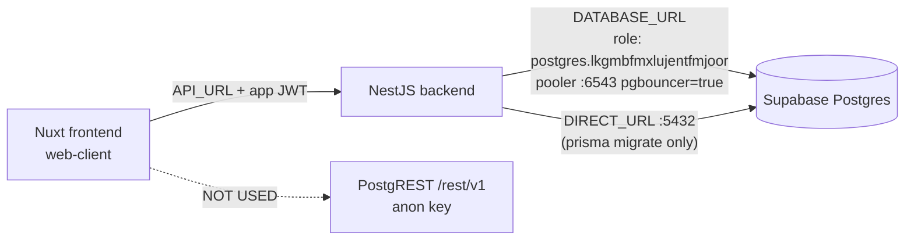

# Supabase RLS Hardening Plan

**Status:** PLANNED — not executed. No database changes have been made.
**Project:** `bank village` (`lkgmbfmxlujentfmjoor`, ap-southeast-1, Postgres 17.4)
**Created:** 2026-11-08

---

## 1. Problem

Supabase Advisor reports `rls_disabled` (CRITICAL) on all 5 tables in `public`:

| Table | Rows (actual) | RLS |
|---|---|---|
| `User` | 182 | ❌ disabled |
| `Account` | 362 | ❌ disabled |
| `Transaction` | 16,399 | ❌ disabled |
| `InterestRate` | 0 | ❌ disabled |
| `_prisma_migrations` | 0 | ❌ disabled |

Because RLS is off, Supabase's auto-generated PostgREST endpoint
(`https://lkgmbfmxlujentfmjoor.supabase.co/rest/v1/`) is reachable with the
**anon key** — a key that is public by design and safe to embed in clients.
Anyone holding it can currently `SELECT` / `INSERT` / `UPDATE` / `DELETE`
every row, including user PII and financial transactions.

## 2. Current Architecture (verified)



Evidence:

- `backend/src/prisma/prisma.service.ts` → `PrismaPg({ connectionString: process.env.DATABASE_URL })`
- `DATABASE_URL` user = `postgres.lkgmbfmxlujentfmjoor` (table **owner**), not `anon`
- `DIRECT_URL` = same host, port `5432`, used for migrations
- `web-client/.env` contains only `API_URL` — no `SUPABASE_*` variables
- No `@supabase/supabase-js` in either `package.json`
- No Supabase Storage / Auth / Realtime usage anywhere in the repo

**Conclusion:** the app never uses the anon key. PostgREST is an unused,
unprotected attack surface.

## 3. Goal

Close the anon-key exposure **without changing backend behaviour or deploy
pipeline**.

Non-goals (explicitly out of scope):

- No migration to Supabase Auth
- No change to Prisma schema, migrations, or `DATABASE_URL` / `DIRECT_URL`
- No change to NestJS code, Dockerfile, or Render env vars
- No table restructuring

## 4. Why the backend keeps working

| Actor | Role | RLS effect |
|---|---|---|
| NestJS backend (Prisma) | `postgres` (table owner) | **Bypassed** — owners bypass RLS unless `FORCE ROW LEVEL SECURITY` |
| `prisma migrate` | `postgres` via `DIRECT_URL` | Bypassed |
| Supabase SQL Editor / Studio | `postgres` / `service_role` | Bypassed |
| PostgREST with anon key | `anon` | **Blocked** — no policies ⇒ zero rows |
| PostgREST with service_role key | `service_role` | Bypassed (key must stay server-side) |

`FORCE ROW LEVEL SECURITY` will **not** be used — it would break the backend.

## 5. Options Considered

| # | Option | Effect on anon | Effect on backend | Reversible | Verdict |
|---|---|---|---|---|---|
| A | `ENABLE ROW LEVEL SECURITY` with no policies | Returns `200 []` (empty) | None | ✅ `DISABLE` | **Recommended** |
| B | `REVOKE ALL ON TABLE ... FROM anon, authenticated` | Returns `401 permission denied` | None | ✅ `GRANT` back | Optional hardening, can stack on A |
| C | Rotate anon key | None (key is public by design) | None | — | ❌ pointless |
| D | Disable PostgREST entirely | Blocked | None | Needs support ticket | ❌ not self-service |
| E | `FORCE ROW LEVEL SECURITY` | Blocked | **BREAKS** | ✅ | ❌ rejected |

## 6. Execution Steps

> Run in Supabase SQL Editor (or `supabase-apply_migration`). Each step is
> independently reversible. Do **not** batch steps 6.1 and 6.3 together —
> verify between them.

### Step 6.1 — Baseline capture (read-only)

Record current anon-key exposure so the fix can be proven:

```bash
# Replace <ANON_KEY> with the project's anon/publishable key
curl -s "https://lkgmbfmxlujentfmjoor.supabase.co/rest/v1/User?select=id&limit=1" \
  -H "apikey: <ANON_KEY>" -H "Authorization: Bearer <ANON_KEY>"
```

Expected **before**: `[{"id":...}]` (data leaks).
Expected **after**: `[]`.

Also snapshot row counts for post-change comparison:

```sql
SELECT 'User' AS t, COUNT(*) FROM "User"
UNION ALL SELECT 'Account', COUNT(*) FROM "Account"
UNION ALL SELECT 'Transaction', COUNT(*) FROM "Transaction"
UNION ALL SELECT 'InterestRate', COUNT(*) FROM "InterestRate";
```

### Step 6.2 — Enable RLS (deny-all)

```sql
ALTER TABLE "public"."User"               ENABLE ROW LEVEL SECURITY;
ALTER TABLE "public"."Account"            ENABLE ROW LEVEL SECURITY;
ALTER TABLE "public"."Transaction"        ENABLE ROW LEVEL SECURITY;
ALTER TABLE "public"."InterestRate"       ENABLE ROW LEVEL SECURITY;
ALTER TABLE "public"."_prisma_migrations" ENABLE ROW LEVEL SECURITY;
```

Notes:

- Metadata-only change; takes a brief `ACCESS EXCLUSIVE` lock per table
  (milliseconds). Safe to run during low traffic.
- No `CREATE POLICY` statements — absence of policies = deny-all for
  non-owner roles.
- No PostgREST schema-cache reload needed.

### Step 6.3 — Verify backend still works

1. `cd backend && bun run start:dev` (or hit the deployed Render service)
2. Exercise read + write paths:
   - `GET /users` (list)
   - `GET /accounts/:id` (detail)
   - `POST /accounts/:id/deposit` (write, inside `$transaction`)
   - `GET /reports/list-user-receive-interest?accountType=SAVING&year=2026`
3. Confirm row counts unchanged from Step 6.1.
4. Confirm `prisma migrate status` reports no drift (uses `DIRECT_URL`).

### Step 6.4 — Verify anon is blocked

Re-run the Step 6.1 `curl`. Expect `[]` with HTTP 200.

### Step 6.5 — Re-run Supabase Advisor

`get_advisors(type: "security")` → `rls_disabled` should be gone.

### Step 6.6 (optional) — Revoke grants (Option B)

Stronger signal (`401` instead of silent `[]`):

```sql
REVOKE ALL ON TABLE "public"."User", "public"."Account",
  "public"."Transaction", "public"."InterestRate",
  "public"."_prisma_migrations" FROM anon, authenticated;
```

Only do this if no future plan involves Supabase client-side access.

## 7. Rollback

```sql
ALTER TABLE "public"."User"               DISABLE ROW LEVEL SECURITY;
ALTER TABLE "public"."Account"            DISABLE ROW LEVEL SECURITY;
ALTER TABLE "public"."Transaction"        DISABLE ROW LEVEL SECURITY;
ALTER TABLE "public"."InterestRate"       DISABLE ROW LEVEL SECURITY;
ALTER TABLE "public"."_prisma_migrations" DISABLE ROW LEVEL SECURITY;
```

Instant, no data loss. Backend is unaffected either way, so rollback is only
needed if a future client-side Supabase integration is added.

## 8. Secret Hygiene (separate, do before/alongside)

- [ ] Confirm `backend/.env` is gitignored — ✅ `*.env` / `*.env.*` in `backend/.gitignore`
- [ ] Confirm no `.env` ever committed: `git log --all --full-history -- "**/.env" "**/.env.*"`
- [ ] Confirm no JWT-style key (`eyJhbGciOi...`) in tracked files:
      `git grep -n "eyJhbGciOi" $(git rev-list --all)` (or GitHub secret scanning)
- [ ] Verify Render env vars hold `DATABASE_URL`, `DIRECT_URL`, `SALT_JWT_SECRET`,
      `SAVING_INTEREST`, `STOCK_INTEREST`, `LOAN_INTEREST` — and nothing else
- [ ] If the DB password ever leaked, rotate it in Supabase → Settings → Database
      and update Render + local `.env`
- [ ] `service_role` key: never place in `web-client` or any `VITE_*` / `NUXT_PUBLIC_*` var

## 9. Risks

| Risk | Likelihood | Mitigation |
|---|---|---|
| Backend breaks after RLS | Very low (owner bypass) | Step 6.3 verification before declaring done |
| Future Supabase client feature silently returns `[]` | Medium | Document in `AGENTS.md`; add policies when needed |
| Brief lock during `ALTER TABLE` | Low | Run off-peak; 5 statements, ms each |
| Someone later adds `FORCE ROW LEVEL SECURITY` | Low | Note in plan + code review |

## 10. Definition of Done

- [ ] All 5 tables show `rls_enabled = true`
- [ ] Advisor `rls_disabled` finding cleared
- [ ] anon-key `curl` returns `[]`
- [ ] Backend read + write + report endpoints verified
- [ ] Row counts identical to baseline
- [ ] `prisma migrate status` clean
- [ ] Secret-hygiene checklist completed
